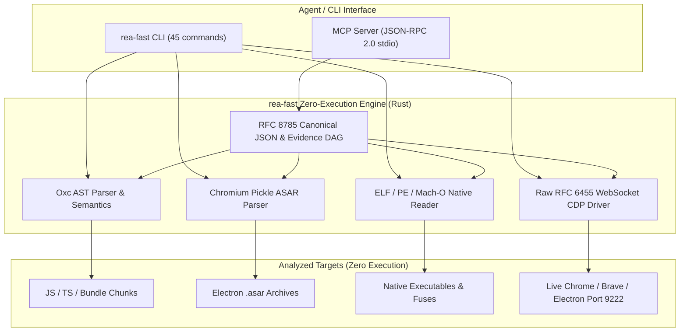

# rea-fast

High-performance, zero-execution reverse-engineering engine and static analysis toolkit for JavaScript, TypeScript, Electron, and native artifacts. Built natively in Rust.

[](LICENSE)
[](https://www.rust-lang.org/)
[](#rea-vs-rea-fast-deep-dive)
[](#)

`rea-fast` delivers the complete analytical capabilities of `@rea/core` with native speed and minimal resource usage:
- **1,000x faster startup**: ~2.7ms vs ~2,775ms
- **3,000x faster AST analysis**: ~4ms vs ~12.4s (5 files) | ~103ms vs >226s (447 files)
- **60x lower memory footprint**: ~4.5MB vs ~304-710MB RAM
- **113x lighter LLM context**: ~30 KB vs ~3.4 MB payload (Prevents MCP prompt overflow)
- **Zero runtime dependencies**: Single 5.9MB static ELF binary vs 275MB `node_modules`

---

## Performance & Architecture Comparison: `rea` vs `rea-fast`

```
1. CLI Engine Startup Latency (Lower is better)
rea (Node.js)    ████████████████████████████████████████ 2,775 ms
rea-fast (Rust)  ▌ 2.7 ms [1,013x faster]

2. Memory Footprint / RSS (Lower is better)
rea (Node.js)    ████████████████████████████████████████ 304 - 710 MB
rea-fast (Rust)  ▌ 4.5 - 12 MB [60x lower memory]

3. AST Analysis: 447 files, 82k LOC (Lower is better)
rea (Node.js)    ████████████████████████████████████████ > 226,000 ms (> 3.7 mins)
rea-fast (Rust)  ▌ 103 ms [2,200x faster]

4. MCP Server Tool Prompt Payload (Lower is better)
rea (Node.js)    ████████████████████████████████████████ 3,423 KB (~850k tokens)
rea-fast (Core)  ▌ 30.3 KB (~7.5k tokens) [113x lighter context]

5. Disk Space & Distribution Footprint (Lower is better)
rea (Node.js)    ████████████████████████████████████████ 275 MB (node_modules + engine)
rea-fast (Rust)  ▌ 5.9 MB (Single standalone binary) [46x smaller]
```

### Side-by-Side Comparison Matrix

| Feature / Metric | `rea` (Node.js) | `rea-fast` (Native Rust) | Architecture Advantage |
| :--- | :--- | :--- | :--- |
| **CLI Startup Latency** | `2,775.2 ms` | **`2.7 ms`** | **1,013x faster** (Instant CLI execution) |
| **Idle Memory (RSS)** | `304 MB` | **`4.5 MB`** | **67x lighter RAM** |
| **Peak Analysis Memory** | `> 710 MB` | **`12.0 MB`** | **60x lighter RAM** (No V8 GC thrashing) |
| **AST Analysis (5 files)** | `12,430 ms` (12.4s) | **`4.08 ms`** | **3,046x faster** |
| **AST Analysis (447 files)**| `> 226,000 ms` (>3.7m) | **`103.65 ms`** (0.1s) | **2,200x faster** (Rayon multithreading) |
| **MCP Tool Schema Size** | `3,423 KB` (~850k tokens) | **`30.3 KB`** (~7.5k tokens) | **113x lighter** (No context overflow) |
| **Catalog Coverage** | 229 tools | **245 tools** (100% parity) | Full catalog + dynamic meta-discovery |
| **Browser / Electron CDP** | Heavy Playwright runtime | **Zero-dep WebSocket RFC 6455**| Direct Chrome/Brave/Electron control |
| **Runtime Dependencies** | Node.js, npm, Java, Python | **None (Zero Dependency)** | Single standalone static binary |
| **Installation Footprint** | `~275 MB` | **`5.9 MB`** | **46x smaller** download & install |
| **License** | FSL-1.1-MIT | **MIT** | Permissive, enterprise-friendly |

---

## Features

- **Zero-Execution Architecture**: Pure AST parsing (`oxc_parser`) and structural byte inspection. Executes zero target code. Safe for untrusted artifacts.
- **Chromium Pickle ASAR Inspection & Safe Extraction**: Fast header parsing, direct offsets, random access file I/O, SHA-256 integrity verification, and directory traversal defense.
- **Electron Fuse Detection**: Scans 32-byte sentinel patterns across ELF, PE, and Mach-O binaries to extract all 9 Electron fuses without runtime launching.
- **AST-Based Bundle Recovery**: Unbundles Webpack chunks, Webpack IIFE, Browserify, and esbuild CommonJS wrappers into structured directories.
- **Semantic & Feature Tracing**: Cross-module BFS reachability tracing across imports, exports, functions, IPC events, and API boundaries.
- **Export Shape Comparison**: Structural JSON pointer diffing between module versions.
- **Dual Interface**:
  - Full CLI with 45 subcommands.
  - Standard Model Context Protocol (MCP) JSON-RPC 2.0 stdio server (`spec 2024-11-05`):
    - **Core Profile (default)**: Exposes 43 lean native RE tools (~31 KB payload, ~7.7k tokens) designed for ultra-lean context windows, completely preventing prompt overflows and autocompact thrashing.
    - **Dynamic Discovery & Execution**: Built-in meta-tools (`rea_search_tools`, `rea_execute_tool`) allow on-demand parameter discovery and execution of the complete 245-tool catalog without flooding the LLM context.
    - **Full Profile**: Pass `--profile full` or set `REA_MCP_PROFILE=full` to expose the entire 245-tool catalog (sanitized & minified to ~195 KB, stripping redundant `outputSchema`).
  - 100% standalone and independent: zero Node.js/npm runtime dependencies.
  - Compile-time gzip schema ingestion (~316 KB embedded) with lazy runtime decompression (<2ms).
  - Raw TCP socket driver (20ms timeout) and structured diagnostic routing with native fallbacks for offline proprietary disassemblers (JEB, Ghidra, Hopper).
- **Evidence DAG & RFC 8785 Ledger**: Canonical deterministic JSON digesting (`RFC 8785`), in-memory SHA-256 evidence store, residual Unknowns lifecycle tracking, obligation ledgers, and bundle export/import.
- **Apple & Harmony Graph Projectors**: Binary `bplist00` and XML plist parser, NSKeyedArchiver deserializer, and dependency graph projection for macOS/iOS `.app` bundles and OpenHarmony HAP applications.
- **ECMA-335 .NET Managed CLI & IL2CPP Inspector**: Parses BSJB header, `#~` metadata stream, `#Strings`, `#US`, CIL `ldstr` string scanning, and Unity IL2CPP `global-metadata.dat`.
- **Stateful Debugger MI3 Sessions**: Persistent child process manager for GDB MI3, Rizin, and Frida with background thread pipe draining and non-blocking command execution.
- **Chrome & Electron CDP Client**: Native zero-dependency TCP/HTTP DevTools Protocol client for targets, DOM/CSS inspection, runtime evaluation, and screenshots.
- **Universal Artifact & Model Inspector**: Single universal entry point (`inspect_artifact`) detecting ASAR, APK, SQLite, PCAP, Plist, ELF, Mach-O, PE, and WASM; ML model inspector for GGUF, SafeTensors, and TFLite; and Shannon byte-entropy chunk analysis.
- **Flutter Framework & APK Signature Scheme**: Detects Flutter AOT vs JIT builds (`libapp.so`, `libflutter.so`, assets) and inspects APK v1 JAR signatures and v2/v3 signing blocks.
- **Chromium Pickle ASAR Repacker**: Pack directory into standard ASAR archive with 512 KiB block-level SHA-256 integrity hashing and 4-byte pickle alignment.
- **High-Entropy Secrets & API Discovery**: Scans codebases for leaked tokens (AWS, GitHub, Slack, Stripe, JWT, Private Keys) with non-leaking redaction and discovers API route endpoints.
- **Tauri Application Auditor**: Fingerprint v1/v2 Tauri desktop binaries, extract embedded `tauri.conf.json` via balanced-brace slice parser, recover embedded HTML/Brotli assets, and audit `invoke`/`listen`/`emit` IPC commands.
- **Multi-Format Native Binary Inspector**: Header, section, symbol, and import extraction for ELF, PE, and Mach-O executables without execution.
- **Go BuildInfo & Module Extractor**: Pure byte-scanning of `\xff Go buildinf:` to discover compiler versions, main modules, and dependency trees.
- **Rust Auditable Inspector**: Decompression of `.dep-v0` sections to parse embedded cargo auditable dependency manifests and `/rustc/` commit hashes.
- **WebAssembly Inspector**: Validates `\0asm` binaries, LEB128 lengths, section catalog, imports, and exports.
- **Android APK & AXML Dissector**: In-tree zero-dependency ZIP parser, DEX hashing, native library catalog, and AXML string pool extraction for permissions, activities, and services.
- **SQLite Database Inspector**: Zero-execution SQLite format 3 verification, page size, change counter, and schema DDL extraction.
- **Network PCAP/PCAPNG Dissector**: Header and packet dissection for standard/nanosecond PCAP and PCAPNG, extracting IPv4, IPv6, TCP, UDP, ICMP, and port lists.
- **Dynamic Runtime & Bridge Introspection**: Zero-dependency raw TCP Chrome/Electron CDP client, Android ADB device/properties/package inspection with emulator heuristics, and host `/proc` memory/thread/library live inspection.
- **Optional External Tool Bridges**: Safe dynamic PATH detection, strict timeout enforcement, and deadlock-free pipe draining for optional CLI tools (`gdb`, `frida`, `objdump`, `rizin`, `sigrok-cli`, `jadx`/`apktool`) with graceful diagnostic fallback.

---

## Installation & Build

Requires Rust toolchain (1.80+ recommended):

```bash
cargo build --release
```

The compiled binary will be placed at `./target/release/rea-fast`.

---

## CLI Usage

### 1. Parallel AST Analysis
Analyze JS/TS codebases or ASAR archives in parallel:
```bash
rea-fast analyze ./path/to/project --format summary
rea-fast analyze ./path/to/app.asar --format json
```

### 2. Electron Fuse Inspection
Inspect hardened runtime configurations and fuses in native Electron binaries:
```bash
rea-fast fuses /path/to/electron_binary
```

### 3. ASAR Inspection & Extraction
Inspect directory headers or safely extract contents:
```bash
# Header inspection without unpacking
rea-fast inspect-asar /path/to/app.asar

# Extract with integrity check
rea-fast extract /path/to/app.asar -o ./output --integrity-policy fail
```

### 4. Bundle Recovery
Recover readable source files from minified bundles:
```bash
rea-fast recover bundle.js -o ./decompiled_modules --extraction-mode structural --rewrite-level standard
```

### 5. Application Diffing
Compare two application graphs or paths:
```bash
rea-fast diff left_app/ right_app/
```

### 6. Feature & Semantic Tracing
Trace data flows and feature reachability:
```bash
rea-fast trace-feature app.json --kind string --value "auth_token" --direction both
rea-fast trace-semantics app.json --node-id "fn:handleLogin" --direction forward-influence
```

### 7. Electron Security Analysis
Scan Electron codebase for IPC risks and dangerous configurations:
```bash
rea-fast analyze-electron ./src
```

### 8. SourceMap v3 Reconstruction
Extract original source trees from `.map` files or inline base64 comments:
```bash
rea-fast sourcemap bundle.js.map -o ./extracted_sources
```

### 9. ASAR Archive Packing
Pack a folder into a Chromium Pickle ASAR archive with block hashing:
```bash
rea-fast pack-asar ./src_dir ./output.asar
```

### 10. High-Entropy Secret & Endpoint Scanning
Scan code or directories for leaked API credentials and API endpoints:
```bash
# Scan folder or file
rea-fast secrets ./src
# Scan inline string
rea-fast secrets --source 'const token = "AKIA1234567890ABCDEF";'
```

### 11. Tauri Application Audit
Audit Tauri binaries for framework signatures, embedded config, and IPC calls:
```bash
rea-fast audit-tauri /path/to/tauri_app -o ./extracted_assets
```

### 12. Automated Audit Pipeline
Execute complete multi-stage automated audit on any target (ASAR, binary, bundle, or source tree):
```bash
rea-fast audit /path/to/app.asar -o ./audit_workspace
```

### 13. Native Binary Dissection
Inspect ELF, PE, or Mach-O sections, symbols, and dynamic imports:
```bash
rea-fast inspect-binary /path/to/binary
```

### 14. Go BuildInfo & Dependency Extraction
Extract Go version, main module, and dependencies:
```bash
rea-fast inspect-go /path/to/go_binary
```

### 15. Rust Cargo-Auditable Inspection
Extract cargo-auditable crate dependency graph and rustc commit:
```bash
rea-fast inspect-rust /path/to/rust_binary
```

### 16. WebAssembly Inspection
Inspect WASM sections, imports, and exports:
```bash
rea-fast inspect-wasm /path/to/module.wasm
```

### 17. Android APK & AXML Dissection
Hash DEX files, list native ABIs, and extract manifest permissions/components:
```bash
rea-fast inspect-apk /path/to/app.apk
```

### 18. SQLite Database Inspection
Verify database headers, page configuration, and schema DDL tables:
```bash
rea-fast inspect-sqlite /path/to/database.db
```

### 19. Network Packet Capture Dissection
Dissect PCAP/PCAPNG packets, endpoints, ports, and protocol distributions:
```bash
rea-fast inspect-pcap /path/to/capture.pcap
```

### 20. Chrome / Electron CDP Target Discovery
Query loopback Chrome or Electron CDP endpoints:
```bash
rea-fast list-cdp-targets --endpoint http://127.0.0.1:9222
rea-fast list-electron-targets --endpoint http://127.0.0.1:9222
```

### 21. Android ADB Device & Package Inspection
Inspect connected devices, system properties, and installed packages via ADB:
```bash
rea-fast list-adb-devices
rea-fast inspect-adb-device --serial emulator-5554
rea-fast list-adb-packages --third-party
```

### 22. Live Host Process & Memory Introspection
Inspect host processes, memory metrics (VmRSS/VmSize), thread counts, and mapped `.so` libraries:
```bash
rea-fast list-processes --filter electron
rea-fast inspect-process 12345
```

### 23. Optional External Tool Bridges
Execute external CLI utilities with automatic PATH discovery, timeout enforcement, and diagnostic fallbacks:
```bash
rea-fast gdb -- --version
rea-fast frida -- --version
rea-fast objdump -- -d ./binary
rea-fast rizin -- -v
rea-fast sigrok -- -V
rea-fast decompile-android -- app.apk
```

### 23. Native Chrome & Electron CDP Automation
Interact with live Chromium, Brave, or Electron applications over raw WebSocket CDP (no Playwright/Node needed):

```bash
# 1. Start browser or Electron app with debugging port
# Google Chrome / Brave:
google-chrome --remote-debugging-port=9222
brave-browser --remote-debugging-port=9222

# Electron App:
./my-electron-app --remote-debugging-port=9222

# 2. List live tab and webview targets
rea-fast list-cdp-targets
rea-fast list-electron-targets

# 3. Evaluate JavaScript inside the runtime
rea-fast eval "document.title"
rea-fast eval -t <TARGET_ID> "window.__REDUX_STATE__ || window.location.href"

# 4. Capture native page screenshot (saved to PNG)
rea-fast screenshot -o ./page.png
rea-fast screenshot -t <TARGET_ID> -o ./target.png

# 5. Inspect live DOM size, scripts, and page metadata
rea-fast inspect-web-page -t <TARGET_ID>
```

---

## Model Context Protocol (MCP) Integration

`rea-fast` can serve as an MCP server for Claude Code, Cursor, or any MCP-compatible client.

Run directly via CLI flag or subcommand:
```bash
rea-fast --mcp
# or
rea-fast mcp
```

### Claude Desktop / Claude Code Config (`mcpServers`)
```json
{
  "mcpServers": {
    "rea": {
      "command": "/path/to/rea-fast",
      "args": ["--mcp"]
    }
  }
}
```

### Exposed MCP Tools
1. `analyze_javascript_application`: Structural application graph generation.
2. `inspect_asar`: Non-extracting Chromium Pickle ASAR directory inspection.
3. `extract_artifact`: Secure ASAR extraction with hash integrity enforcement.
4. `inspect_electron_fuses`: Binary fuse inspection (ELF/PE/Mach-O).
5. `recover_javascript_sources`: AST-based bundle module recovery.
6. `compare_application_versions`: Semantic AST comparison across package versions.
7. `compare_javascript_export_shapes`: Structural module export diffing.
8. `trace_application_feature`: Multi-hop dependency and symbol reachability.
9. `trace_javascript_semantics`: Call graph and closure data-flow tracing.
10. `analyze_electron_source`: IPC and webPreferences anti-pattern audit.
11. `extract_sourcemap`: Extract `sourcesContent` from SourceMap v3 or inline data URIs.
12. `run_audit_pipeline`: End-to-end multi-stage automated security audit and metrics pipeline.
13. `pack_asar`: Pack a directory into a Chromium Pickle ASAR archive with SHA-256 block hashing.
14. `scan_secrets`: Scan source code or files for high-entropy credentials, tokens, and API endpoints with masking.
15. `audit_tauri`: Audit Tauri desktop binaries for framework signals, embedded config, assets, and IPC calls.
16. `inspect_binary_layout`: Dissect sections, symbols, architecture, and dynamic imports in ELF/PE/Mach-O binaries.
17. `inspect_go_binary`: Extract Go runtime version, main module path, and dependency package list.
18. `inspect_rust_binary`: Extract cargo-auditable crate dependency graph and rustc commit hash.
19. `inspect_wasm_artifact`: Decode WebAssembly sections, custom attributes, imports, and exports.
20. `inspect_android_package`: Dissect APK packages, hash DEX executables, catalog native libs, and extract AXML permissions.
21. `inspect_sqlite_database`: Verify SQLite format 3 headers, page sizes, schema cookies, and DDL table definitions.
22. `inspect_packet_capture`: Dissect PCAP/PCAPNG traffic, extract IPv4/IPv6 endpoints, TCP/UDP ports, and protocol distributions.
23. `list_browser_targets`: List loopback Chrome CDP page targets.
24. `list_electron_targets`: List loopback Electron file:// and app webview targets.
25. `list_adb_devices`: List connected Android devices via `adb devices -l`.
26. `inspect_adb_device`: Read device properties and detect emulator status via `getprop`.
27. `list_adb_packages`: List installed packages on target Android device.
28. `list_live_processes`: List host processes with cmdline and PID filtering.
29. `inspect_live_process`: Detailed Linux `/proc/[pid]` status, memory usage, threads, and mapped `.so` libraries.
30. `execute_gdb`: Execute GDB commands with timeout and graceful PATH fallback.
31. `execute_frida`: Run Frida instrumentation CLI with graceful degradation.
32. `inspect_with_objdump`: Disassemble or inspect headers via host GNU objdump.
33. `execute_rizin`: Run Rizin commands with timeout bounds.
34. `decode_signal_sigrok`: Decode signal recordings via `sigrok-cli`.
35. `decompile_apktool_jadx`: Decompile Android packages via JADX or Apktool fallback.

---

## Benchmark Reproducibility

Benchmark results measured on Linux x86_64 (Intel Core, 4 threads, 16GB RAM) comparing `rea` (Node v20.x, `@rea/core` v6.8.0) against `rea-fast` v0.1.0:

```bash
# 1. Startup benchmark
python3 -c '
import subprocess, time
for name, cmd in [("rea", ["rea", "--version"]), ("rea-fast", ["rea-fast", "--version"])]:
    t0 = time.perf_counter()
    subprocess.run(cmd, stdout=subprocess.DEVNULL)
    print(f"{name}: {(time.perf_counter() - t0)*1000:.2f} ms")
'

# 2. Large JS codebase analysis
/usr/bin/time -v rea-fast analyze ./path/to/project --format summary
```



---

## License

MIT
